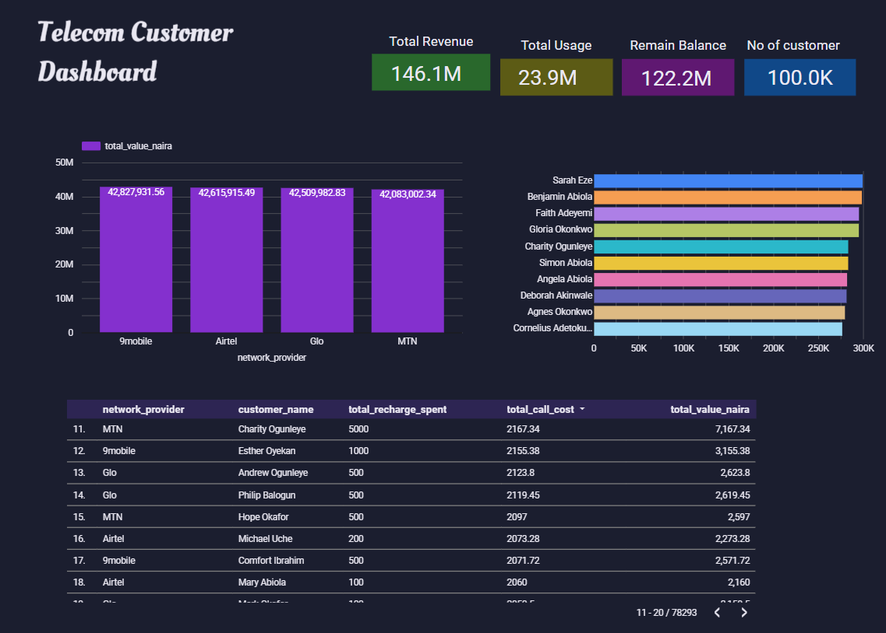

# Telecom Recharge Pipeline

> End-to-end telecom analytics pipeline: Used Python to generate 99,971 customers + recharge & CDR data, modeled in dbt on PostgreSQL, visualized in Data Studio. Found & fixed a duplicate customer_id bug that collapsed 99,971 customers into 999. KPIs reconcilation: 146.1M Naira revenue - 23.8M usage = 122.2M balance.


# Telecom Recharge & Usage Analytics Pipeline

> 🚧 **WORK IN PROGRESS**
>
> An end-to-end telecom analytics engineering project built with Python, PostgreSQL, dbt and Looker Studio. The current implementation combines customer profiles, recharge transactions and Call Detail Records (CDRs) to explore customer activity and value.
>
> The project currently provides a partial customer view (recharge + voice usage + customer profile). Additional customer interaction and service data are still needed to achieve a more comprehensive Customer 360 solution.

## 1. Project Overview

Telecommunications companies generate large volumes of transactional data from customer recharges, voice calls, SMS, data consumption and customer support interactions.

However, these records often exist in separate systems. Analysing them independently makes it difficult to understand how customers use telecom services, how much they recharge, how much they consume and which customer segments contribute most to business activity.

This project explores how different telecom datasets can be brought together through an analytics pipeline to create a consolidated view of customer activity.

Using synthetically generated telecom data, I built a pipeline that:

- Generates customer, recharge and Call Detail Record (CDR) data using Python.
- Stores and manages the datasets in PostgreSQL.
- Transforms raw data into structured analytical models using dbt.
- Creates a customer-level fact table combining recharge and call activity.
- Visualises the resulting metrics using Looker Studio.

The objective is to demonstrate an end-to-end analytical workflow while exploring data quality, relational modelling, transformation logic and the interpretation of business metrics.

## 2. Project Objectives

The project was designed around the following questions:

1. How can customer recharge and usage records be consolidated into a single analytical view?
2. How much do customers recharge, and how much do they consume through voice services?
3. Which network providers contribute the most to recharge and usage activity?
4. Who are the customers with the highest recorded recharge and call activity?
5. How can customer-level data be transformed into metrics that support business decisions?
6. What data quality issues can distort customer-level reporting, and how can they be identified and corrected?

## 3. Technology Stack

| Technology | Purpose |
|---|---|
| Python | Synthetic data generation |
| PostgreSQL | Relational database and SQL transformations |
| PL/pgSQL | Database procedures and functions |
| dbt | Data transformation and modelling |
| Looker Studio | Dashboard development and visualisation |
| Google Sheets | Intermediate data source for Looker Studio |
| Git & GitHub | Version control and project documentation |

## 4. Project Architecture

The pipeline follows a simple analytical engineering workflow:

```text
       SYNTHETIC DATA GENERATION
                  |
                  v
              PYTHON
                  |
          +-------+-------+
          |               |
          v               v
    Recharge Data      CDR Data
          |               |
          +-------+-------+
                  |
                  v
             POSTGRESQL
                  |
                  v
           RAW DATA TABLES
                  |
                  v
                 dbt
                  |
          +-------+-------+
          |               |
          v               v
       STAGING          MARTS
       MODELS           MODELS
          |               |
          +-------+-------+
                  |
                  v
        CUSTOMER-LEVEL MODEL
          fct_customer_360
                  |
                  v
             POSTGRESQL
                  |
                  v
             CSV EXPORT
                  |
                  v
            GOOGLE SHEETS
                  |
                  v
            LOOKER STUDIO
                  |
                  v
          ANALYTICAL INSIGHTS
```

*Note: Google Sheets is currently used as an intermediate connection because Looker Studio cannot directly access my locally hosted PostgreSQL database.*

## 5. Data Generation and Preparation

Since access to real telecom transactional data was not available, I used Python to generate synthetic datasets for the project.

The intention was to simulate selected activities within a prepaid telecommunications environment.

### A. Customer and Recharge Data

The `generate_data.py` script generates the customer and recharge datasets.

The customer records contain information such as:

- Customer phone number
- Customer name
- Email address
- Network provider

Recharge transactions provide information about customer funding activity, including:

- Phone number
- Recharge amount
- Transaction details

The generated customer records provide the reference data used to associate recharge transactions and subsequent call records.

### B. Call Detail Records (CDR)

The `generate_cdr.py` script generates synthetic Call Detail Records.

CDRs represent telecommunications usage records, particularly calls made between subscribers. They are not customer-care calls or complaint records.

The generated records include:

- Caller number
- Receiver number
- Network provider
- Call type
- Call duration
- Call start time
- Call cost
- Call status

The initial test contained only two manually created CDR records. I subsequently developed the generator to select phone numbers from existing recharge customers, ensuring that the generated caller numbers could be matched against the customer dataset.

The CDR generator was later increased from 1,000 to 100,000 records to provide more coverage of customer usage activity.

**Current synthetic dataset:**
- 99,971 customer records.
- Approximately 100,000 generated CDR records.
- Recharge transactions generated through the Python data-generation process.

*All records are synthetic and do not represent actual subscribers or transactions from any telecommunications provider.*

## 6. Database Design and Transformation

PostgreSQL serves as the central database for storing and querying the generated datasets.

The project also includes SQL scripts for database creation, table definitions, procedures, CDR processing and daily summaries.

dbt is used to organise the transformation process into staging and analytical models.

### A. Staging Models

The staging layer prepares the raw datasets for downstream analysis.

Current staging models include:

- `stg_recharge_transactions`
- `stg_cdr_records`
- `stg_daily_summary`

These models provide a structured foundation for joining and aggregating the source records.

### B. Customer Dimension: `dim_customers`

The customer dimension consolidates customer information using phone numbers as the grouping key.

The model:

1. Groups recharge records by phone number.
2. Consolidates customer attributes.
3. Assigns a generated customer ID using `ROW_NUMBER()`.
4. Creates one customer record per distinct phone number in the recharge dataset.

The resulting customer dimension contains:

- `customer_id`
- `phone_number`
- `customer_name`
- `email`
- `network_provider`

This model became particularly important during data validation because an issue in its ID-generation logic initially caused customer records to be incorrectly grouped together.

### C. Customer Fact Model: `fct_customer_360`

The fact model combines customer information with aggregated recharge and CDR activity.

The current model provides metrics such as:

- `customer_id`
- `customer_name`
- `network_provider`
- `total_recharges`
- `total_recharge_spent`
- `total_calls`
- `total_call_cost`
- `total_value_naira`

This creates a consolidated customer-level dataset that can be queried for recharge and voice usage analysis.

The current implementation is a partial Customer 360 view, rather than a complete representation of every customer interaction.

### D. Additional Analytical Model

The project also includes:

- `mart_revenue_by_network.sql`

This model supports the analysis of recharge and revenue-related activity across network providers.

## 7. Data Quality Challenges: What Went Wrong and How I Fixed It

One of the most important parts of this project was discovering that a pipeline can execute successfully while still producing incorrect analytical results.

The following issues were identified during development and validation.

### Challenge 1: Customer ID Collisions

**The problem**

During dashboard validation, the customer count was showing only 999 unique customers, despite the customer dimension containing 99,971 rows.

Initially, I suspected that Looker Studio was incorrectly counting the records.

I investigated the exported dataset in Excel using:

```excel
=COUNTA(UNIQUE(A1:A99972))
```

The result was 999.

I then checked the database:

```sql
SELECT
    COUNT(*) AS total_rows,
    COUNT(DISTINCT customer_id) AS unique_ids
FROM dim_customers;
```

The result was:

| Metric | Initial Result |
|---|---:|
| Total rows | 99,971 |
| Unique customer IDs | 999 |

Further investigation revealed that some customer IDs were being shared by approximately 111 different people.

**Root cause**

The problem was in the `dim_customers` dbt model.

The original ID-generation expression was:

```sql
'CUST/' || lpad(row_num::text, 3, '0') AS customer_id
```

I initially understood the third argument as a minimum padding width.

However, PostgreSQL's `LPAD()` function returns a string of the specified length. When the original value exceeds that length, it truncates the string.

For example:

```text
row_num = 5       -> CUST/005
row_num = 999     -> CUST/999
row_num = 1000    -> CUST/100
row_num = 1001    -> CUST/100
```

Consequently, multiple customers received identical IDs.

**The fix**

I changed the padding length from 3 to 5:

```sql
'CUST/' || lpad(row_num::text, 5, '0') AS customer_id
```

This allowed the generated IDs to accommodate the full dataset.

I rebuilt the affected dbt models and validated the result again.

**Validation after the fix:**

| Metric | Before | After |
|---|---:|---:|
| Total rows | 99,971 | 99,971 |
| Unique customer IDs | 999 | 99,971 |

The corrected model now produces unique IDs for all 99,971 customer records.

**Why this mattered**

The original issue was not simply a counting problem. Duplicate customer IDs could cause unrelated people's recharge and usage records to be aggregated together during joins.

This would distort customer-level metrics, network comparisons and any attempt to identify high-value customers.

It reinforced the importance of checking uniqueness and data grain instead of assuming that a successful transformation means the resulting data is correct.

### Challenge 2: CDR Records Were Not Matching Customers

**The problem**

After creating the initial customer fact model, I noticed that `total_calls` was returning zero for customers.

At first, I suspected that the dbt joins were incorrect.

However, inspecting the CDR table revealed that it contained only two manually created test records:

```text
08031234567 -> 08051234567
08031234567 -> 08021234567
```

I had not yet generated the larger CDR dataset, and these test numbers were not confirmed to exist in the recharge customer records.

**Investigation and resolution**

I changed the CDR generation process so that it retrieved actual phone numbers from the existing recharge table.

The generator then selected callers and receivers from the available customer phone numbers.

This made it possible to link CDR records to the customer dimension through the corresponding phone numbers.

After generating the larger dataset, I reran the dbt transformations.

The resulting customer-level table began showing non-zero call counts and call costs for customers with matching CDR activity.

**Lesson learned**

A join can be syntactically correct and still produce incorrect or empty analytical results when the underlying identifiers do not match.

I learned to investigate the source records and validate key relationships before assuming that a transformation is responsible for an unexpected result.

### Challenge 3: Incorrect Customer Counts in the Final Model

Even after correcting the customer ID issue, I noticed that the customer dimension contained 99,971 customers while the final fact table contained only 78,293 records.

Further investigation showed that the final model used an `INNER JOIN`.

This meant that customers without matching call activity were excluded from the final output.

The behaviour was consistent with the join logic, but it was not necessarily the desired outcome for a comprehensive customer-level report.

I retained the observation as a known limitation rather than treating the smaller output as the total customer population.

## 8. Dashboard and Analytical Exploration

**Live Dashboard:** [https://datastudio.google.com/reporting/3dc7c1d2-7f56-4049-a16b-2cc285def118]




The final analytical output is currently connected to Looker Studio through an exported CSV file uploaded to Google Sheets.

The dashboard was designed to explore customer recharge and voice usage activity.

The current reporting areas include:

- Total customer count.
- Total recharge amount.
- Total recorded call usage cost.
- Estimated remaining balance.
- Recharge and usage activity across network providers.
- Customer-level activity comparisons.

### Current dashboard snapshot

The validated dashboard snapshot showed approximately:

| Metric | Value |
|---|---:|
| Customers in dimension | 99,971 |
| Total recharge amount | ₦146,140,900 |
| Total call usage cost | ₦23,795,932.22 |
| Estimated difference | ₦122,344,967.78 |

These figures describe the synthetic dataset and the current reporting logic, not actual telecom business performance.

The estimated difference is calculated as total recharge amount less recorded call usage cost. Its interpretation as an actual remaining customer balance requires additional validation, particularly because the recharge and CDR generators currently operate independently.

### Questions the dashboard helps explore

- Which network providers have the highest recorded recharge activity?
- Which customers have the highest recharge amounts?
- Which customers have the highest recorded voice usage costs?
- How does customer recharge activity compare with recorded call usage?
- Are there customers whose usage costs exceed their generated recharge amounts?

The dashboard is an exploratory reporting layer. The results should be interpreted alongside the limitations of the synthetic data and the current modelling logic.

## 9. Known Limitations

This project is still evolving. The following limitations have been identified and documented rather than hidden.

### 1. The current customer view is not a complete 360-degree view

The current model combines:

- Customer profile information.
- Recharge activity.
- Voice usage through CDR records.

It does not yet incorporate other important customer interactions, such as data consumption, SMS activity and customer support complaints.

### 2. Customers without call activity are excluded from the current fact table

The `fct_customer_360` model currently uses an `INNER JOIN`.

Consequently, customers without matching CDR activity are excluded.

The dimension contains 99,971 customers, while the dashboard's customer-level table showed 78,293 records.

A `LEFT JOIN` from the customer dimension would be a possible improvement if the objective is to retain all customers, including those with no recorded calls.

### 3. Recharge and usage generation are independent

The recharge and CDR generators do not currently simulate a shared prepaid wallet.

As a result, a customer's generated call cost can exceed their generated recharge amount.

For example, a customer may have ₦2,000 in generated recharge activity and ₦2,677 in recorded usage costs.

This is not a reliable representation of prepaid balance behaviour.

A more realistic implementation would introduce a balance-management process, transaction sequencing and validation before usage is charged.

### 4. Network distribution is synthetic

Network providers are assigned through the synthetic generation process.

The resulting distribution should not be interpreted as evidence of actual market share or revenue dominance among Nigerian telecom operators.

### 5. Customer records originate from recharge data

The current customer dimension is built from phone numbers in `stg_recharge_transactions`.

Customers who have never recharged are therefore not represented in the dimension.

A more complete model would require an independent customer master dataset.

### 6. Dashboard data is not automatically refreshed

The current reporting process involves exporting the PostgreSQL output to CSV, uploading it to Google Sheets and connecting Looker Studio to that sheet.

This is not yet an automated, continuously refreshed reporting pipeline.

### 7. Business metric definitions still need refinement

The current model includes `total_value_naira`, which combines recharge spending and call usage cost.

However, recharge is the amount loaded by a customer, while call cost represents consumption of telecom services.

Adding these two amounts together may count the same underlying funds twice.

The metric therefore needs a clearer business definition before it can be presented as customer lifetime value, total revenue or profitability.

Similarly, an estimated remaining balance should only be treated as a genuine prepaid balance after transaction-level reconciliation and wallet logic are implemented.

## 10. Development Roadmap

The next phase of development will focus on improving the completeness, reliability and business relevance of the pipeline.

### Data expansion

- [ ] Add data usage records, including MB consumed.
- [ ] Add SMS transaction records.
- [ ] Introduce customer support tickets and complaints.
- [ ] Introduce a standalone customer master dataset.
- [ ] Add customer demographics and location where appropriate.

### Data modelling and quality

- [ ] Rework the customer fact model to retain customers without call activity.
- [ ] Introduce more robust customer and transaction identifiers.
- [ ] Add dbt uniqueness, not-null and relationship tests.
- [ ] Validate source-to-model reconciliation.
- [ ] Improve transaction-level aggregation and business metric definitions.
- [ ] Introduce realistic prepaid wallet and balance-management logic.

### Analytics and reporting

- [ ] Develop customer segmentation.
- [ ] Introduce a more meaningful customer value metric.
- [ ] Explore churn indicators using recharge and usage behaviour.
- [ ] Analyse complaint frequency alongside customer activity.
- [ ] Improve network-level comparisons.
- [ ] Automate the database-to-dashboard refresh process.

### Engineering improvements

- [ ] Improve configuration and credential management.
- [ ] Add repeatable database setup and data-loading instructions.
- [ ] Document SQL procedures and their execution.
- [ ] Introduce automated pipeline validation.

## 11. Running the Project

The project is developed locally using PostgreSQL and a Python virtual environment.

### Prerequisites

- Python
- PostgreSQL
- dbt with the PostgreSQL adapter
- Required Python packages for the data generators
- Looker Studio and Google Sheets for reporting

### Execution workflow

1. Clone the repository.
2. Set up the Python environment and install the required dependencies.
3. Create the PostgreSQL database and tables using the SQL scripts.
4. Configure the database connection used by the Python generators.
5. Generate the customer and recharge datasets using `generate_data.py`.
6. Load the generated recharge data into PostgreSQL.
7. Generate CDR records using `generate_cdr.py`.
8. Execute the relevant SQL scripts and prepare the source tables.
9. Navigate to the dbt project directory:

```powershell
cd telecom_dbt
```

10. Configure the dbt PostgreSQL connection in the local profiles configuration.
11. Execute the transformations:

```bash
dbt run
```

12. Validate the resulting tables using SQL queries.
13. Export the analytical output to CSV, upload it to Google Sheets and connect it to Looker Studio.

*Note: The exact dependency list, database credentials, CSV-loading commands and complete setup instructions are still being documented. Never commit local credentials or passwords to the repository.*

## 12. Key Takeaways

This project has been an opportunity to work beyond writing SQL queries and creating visualisations.

It has involved building a data-generation process, structuring relational data, developing transformation models, investigating unexpected outputs and validating analytical results.

Some of the most valuable lessons came from the problems encountered during development:

- A successful pipeline execution does not automatically guarantee accurate data.
- Data grain and identifier uniqueness must be validated before joining datasets.
- Source data quality directly affects downstream analytical results.
- A technically correct aggregation can still have an incorrect business interpretation.
- A dashboard should communicate what the data actually represents, not just display attractive metrics.
- Documenting known limitations is part of building reliable analytical systems.

The project is still a work in progress, and the next phase will focus on improving data completeness, modelling accuracy and the business logic behind the reported metrics.

---

**Project Status:** Work in Progress

**Author:** Latifah Usaini Bashir

**Focus:** Data Analytics | Analytics Engineering | SQL | Data Modelling | Python

